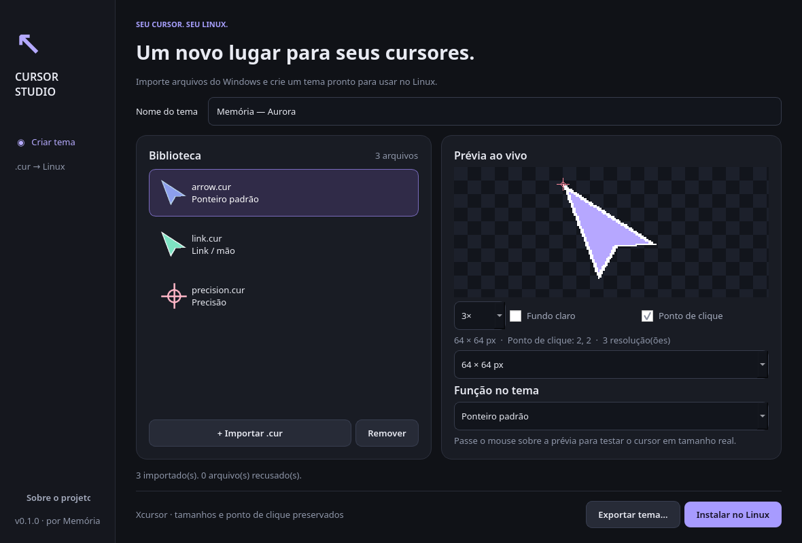

<div align="center">


# Cursor Studio

**Your Windows cursors. At home on Linux.**

A native Qt 6 desktop app to preview `.cur` files and turn them into installable Xcursor themes.

[](https://github.com/carlosmemoria/cursor-studio/actions/workflows/ci.yml)


[Português](#português) · [Install](#installation) · [CLI](#command-line) · [Contribute](CONTRIBUTING.md)

</div>



## What it does

- Drag and drop static Windows `.cur` files, individually or in batches.
- Preview transparency on light/dark backgrounds, inspect each resolution and display the click hotspot.
- Hover over the preview to try the cursor at its real size.
- Assign cursor roles using a visual inspector; common filenames are suggested automatically.
- Export a theme folder or install it for the current user, without root access.
- Preserve embedded resolutions, alpha transparency and per-resolution hotspots.
- Generate canonical Xcursor names and common CSS/legacy aliases.
- Convert from the command line without starting Qt.

All processing is local. The app does not upload cursors, run Windows installers or change your active cursor theme.

## Scope and compatibility

**Version 0.1 is a beta for static `.cur` cursors.** Animated `.ani`, INF import, archive import, session persistence and automatic theme activation are not implemented. Imported projects live in memory; exported themes are saved on disk.

CUR images encoded as PNG or DIB are decoded using Pillow. Xcursor serialization is implemented in this project, with premultiplied ARGB pixels. Alternate images with identical dimensions are collapsed to the last entry. The app supports up to 200 files per session, 128 images per file and 32 MiB per input file, with a 256 MiB decoded-image budget per session.

Themes target desktops that consume Xcursor, including common KDE/GNOME setups on X11 and Wayland. Selection and fallback behavior depend on the desktop/compositor. Missing roles inherit `Adwaita` when it is installed; the app does not manufacture unavailable cursor artwork. The first release is tested on Debian; other distributions are not yet verified. The GUI is currently in Brazilian Portuguese.

## Installation

Requires Linux, Python 3.11+ and Qt 6 runtime libraries. On Debian/Ubuntu:

```bash
sudo apt install git python3-venv libegl1 libopengl0 libxcb-cursor0

git clone https://github.com/carlosmemoria/cursor-studio.git
cd cursor-studio
python3 -m venv .venv
.venv/bin/python -m pip install .
.venv/bin/cursor-studio
```

Optional application-menu launcher:

```bash
.venv/bin/python packaging/install-desktop.py
```

The launcher points to this environment. Keep the repository and `.venv` at the same location, or rerun the installer after moving them. Remove `~/.local/share/applications/cursor-studio.desktop` and `~/.local/share/icons/hicolor/scalable/apps/cursor-studio.svg` to uninstall that launcher (adjust for `XDG_DATA_HOME`). No PyPI package or standalone binary has been published yet.

## Workflow

1. Import your `.cur` files with **Importar .cur**, drag and drop, or `Ctrl+O`.
2. Select a file and inspect its preview and resolutions.
3. Choose a role under **Função no tema**. Assign at least **Ponteiro padrão**. Each role can only be assigned once.
4. Name the theme. **Exportar tema** creates a folder in your chosen destination; **Instalar no Linux** writes to `$XDG_DATA_HOME/icons` (default `~/.local/share/icons`).
5. Select the installed theme in your desktop's appearance settings. Reopen those settings if the theme list is cached.

Existing theme folders are never overwritten. Choose another theme name or destination to export again. Deleting a file from the app only removes it from the current session, never from disk.

## Command line

```bash
# Raw Xcursor output (destination must not exist)
.venv/bin/cursor-studio-cli convert arrow.cur left_ptr

# Complete theme; output is a parent directory
.venv/bin/cursor-studio-cli theme --name 'My Theme' --output ./themes \
  left_ptr=arrow.cur hand2=link.cur xterm=text.cur
```

Use `--help` on either subcommand. Theme roles are listed in `src/cursor_studio/core.py`. Quoting paths containing spaces follows your shell's normal rules.

## Development

```bash
.venv/bin/python -m pip install -e '.[dev]'
.venv/bin/ruff check .
QT_QPA_PLATFORM=offscreen .venv/bin/pytest -q
.venv/bin/python -m build
```

Tests cover PNG/DIB CUR decoding, hotspots, malformed input, premultiplied pixels, theme aliases, overwrite protection, CLI behavior and GUI state transitions. When `libXcursor` is present, an integration test opens the generated files through the system library. CI runs on Python 3.11–3.13.

## Português

**Cursor Studio** converte cursores estáticos do Windows (`.cur`) em temas para Linux, com uma interface nativa em português. Importe seus arquivos, confira a prévia, associe as funções e exporte ou instale o tema. A instalação é feita apenas na sua conta; depois, selecione o tema nas configurações de aparência do KDE, GNOME ou do seu ambiente.

Para instalar, siga os comandos da seção [Installation](#installation). A versão inicial não aceita `.ani`; não há suporte a animações nem salvamento do projeto de edição. Os temas exportados ficam salvos normalmente. A aplicação não sobrescreve temas existentes.

## Related work and credits

This project was started after reviewing existing converters, including [win2xcur](https://github.com/quantum5/win2xcur) and [ani2xcur](https://github.com/licyk/ani2xcur). It does not bundle or copy their conversion code. Cursor Studio focuses on a native visual workflow and uses its own CUR-container parsing and Xcursor writer, with [Pillow](https://python-pillow.github.io/) for image decoding and [Qt for Python](https://doc.qt.io/qtforpython-6/) for the interface.

Format reference: [libXcursor source and format definitions](https://gitlab.freedesktop.org/xorg/lib/libxcursor). Pillow and Qt retain their own licenses; see [THIRD_PARTY_NOTICES.md](THIRD_PARTY_NOTICES.md).

Original demo artwork and application icon are included in this repository. Windows cursor packs are not bundled; respect the license of any cursor artwork you import or redistribute.

Created by **Carlos Memória** · [memoria.pro](https://memoria.pro) · [MIT](LICENSE)
